# Listening to a TETRA Cell with an RTL-SDR and (Mostly) Stock GNU Radio Blocks

*One carrier, four timeslots, and a base station that never stops announcing who it is. This is the build log of my TETRA receiver: stock GNU Radio blocks from the RTL-SDR all the way to the cell's broadcast messages, a little Python where nothing stock exists, and finally clear speech from a live call coming out of my laptop speaker. Plus the eight bugs that stood in the way.*

[Code repo here](https://github.com/handiko/TETRA-Rx)

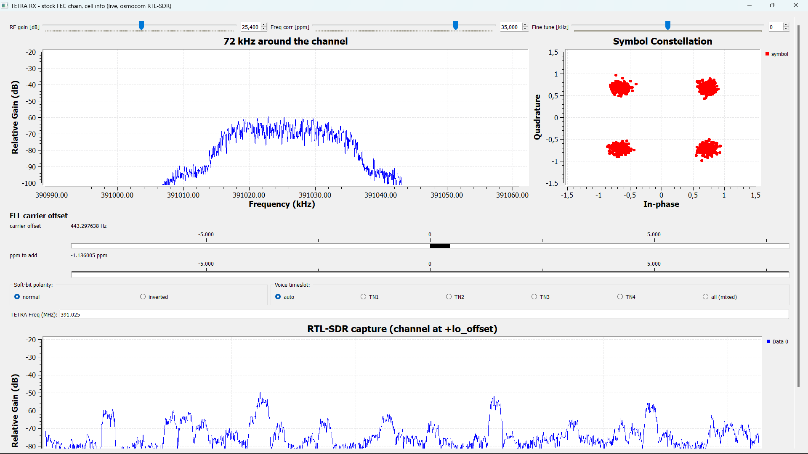

---

## Why I did this

Somewhere around 390–393 MHz near me there are TETRA base stations transmitting nonstop. On a waterfall they look like solid 25 kHz-wide bars: no gaps, no breathing, nothing to see. They never switch off, and they never tell you anything by just looking at them.

Inside those bars, though, there's a whole little world. Every cell keeps announcing who it is (country, network, colour code), which carrier is its main one, how mobiles should behave when they access it, and what services it offers. And four times every 57 milliseconds, the carrier is chopped into timeslots, some of which may carry speech.

There are ready-made decoders for this (osmo-tetra's `tetra-rx` is the classic). I didn't want a black box. I wanted to build the receiver myself, on my Windows laptop, out of stock GNU Radio blocks wherever possible, so I could put a display on any stage and see what it does.

That's this flowgraph, `tetra_rx_stock.grc`. Part 1 explains what a TETRA downlink actually is. Parts 2 to 5 walk through the receiver, antenna to console. Part 6 is the voice path, and Part 7 is the story of everything that was wrong with my first version of it. And yes, in the end it works: on a live cell it decodes the broadcast channels at better than 99 % and plays clear calls from whichever timeslot is busy.

**A word before I start.** TETRA carries other people's traffic, often public-safety traffic. Everything in Parts 1–5 is what the network *broadcasts to everyone*: identity, system information, access rules. Part 6 plays actual calls, and listening to someone else's calls may be illegal where you live, so check before you point it at a real cell. Many networks encrypt their calls; an encrypted call comes out as noise, which is how it's supposed to be. (Careful, though: the "AIR ENCRYPTION" line my receiver prints doesn't mean every call is encrypted. More on that in Part 7.)

As usual I use a handful of DSP words (correlator, soft bit, Viterbi, scrambler…). I explain each one the first time it shows up.

---

## What I used

- **RTL-SDR dongle.** My calibration comment says "35 ppm", which tells you how good its crystal is.
- **A 70 cm antenna.** Nothing special.
- **Windows laptop** with **radioconda** (GNU Radio 3.10). No out-of-tree modules: the RTL-SDR goes through the in-tree **Soapy RTLSDR Source**.
- **Gqrx**, for recordings I can replay at my desk (`gqrx_..._390600000_1200000_fc.raw`: 1.2 MS/s centred on 390.600 MHz).
- **tetra_dec.dll**, my own build of the ETSI TETRA speech codec reference code (EN 300 395-2). Only the voice path needs it.

The files:

- **tetra_rx_stock.grc**: the flowgraph. It's self-contained: both Python blocks and the tables module live inside it, and GRC writes them out when you generate.
- **tetra_testgen.py**: makes a synthetic TETRA downlink for testing (numpy only).
- **tetra_pe_\*.svg**: the eleven diagrams in this document. Keep them in the same folder.

---

## The rule I followed

Same rule as all my GNU Radio projects:

> Put each operation in a stock block if one exists. Use an Embedded Python Block (EPB) only for what GNU Radio cannot do natively.

For TETRA this turned out to go much further than I expected. Frame sync, burst cutting, descrambling, de-interleaving, de-puncturing and Viterbi decoding are **all** stock blocks. Python only does:

1. the **CRC check and message parsing** (TETRA's CRC covers 76 or 140 bits; the stock CRC blocks only handle whole bytes), and
2. the **voice path**: working out which timeslot a burst belongs to, and calling the ETSI speech decoder.

Here's the whole receiver on one page:

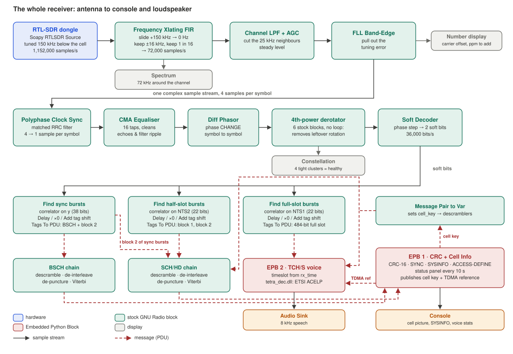

Plain boxes are stock blocks, double-bordered ones are my two Python blocks, and boxes with a little screen icon are displays. Solid arrows carry samples, dashed arrows carry messages (one per burst or per event), and dotted arrows are GRC variable updates. A dashed frame groups the symbols that live inside one GRC block. The rest of this story walks through it top to bottom.

---

## Part 1: what a TETRA downlink is

### The signal

A TETRA base station transmits on a **25 kHz channel** using **π/4-DQPSK**:

- **18,000 symbols per second**, two bits per symbol, so **36,000 bits per second** per carrier;
- each symbol **turns the phase** by one of four amounts: +45°, +135°, −45° or −135°. Which one encodes the two bits (00, 01, 10, 11). The information is in the *change* of phase, not the phase itself;
- the pulses are shaped with a root-raised-cosine filter (roll-off 0.35), so the signal really occupies ±12.15 kHz.

The base station's main carrier **never stops transmitting**. That's handy: there's always something to lock onto.

### Chopping time into boxes

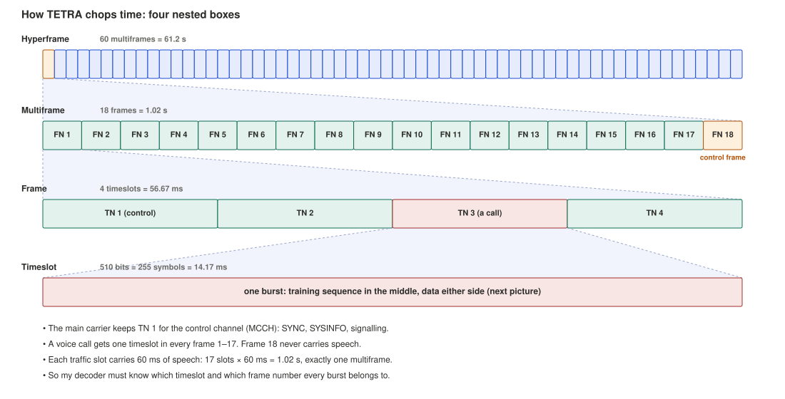

TETRA is TDMA: one carrier, shared in time. It nests four boxes:

| Box | Made of | Lasts |
|---|---|---|
| **Timeslot** | 510 bits (255 symbols) | 14.17 ms |
| **Frame** | 4 timeslots (TN 1–4) | 56.67 ms |
| **Multiframe** | 18 frames (FN 1–18) | 1.02 s |
| **Hyperframe** | 60 multiframes | 61.2 s |

Two facts matter later:

- **Frame 18 is the control frame.** It never carries speech. Among other things, it carries the sync bursts.
- **A voice call gets one timeslot in every frame 1–17.** Each of those slots carries 60 ms of speech, and 17 × 60 ms = 1.02 s: exactly one multiframe. Clever.

### Three kinds of burst

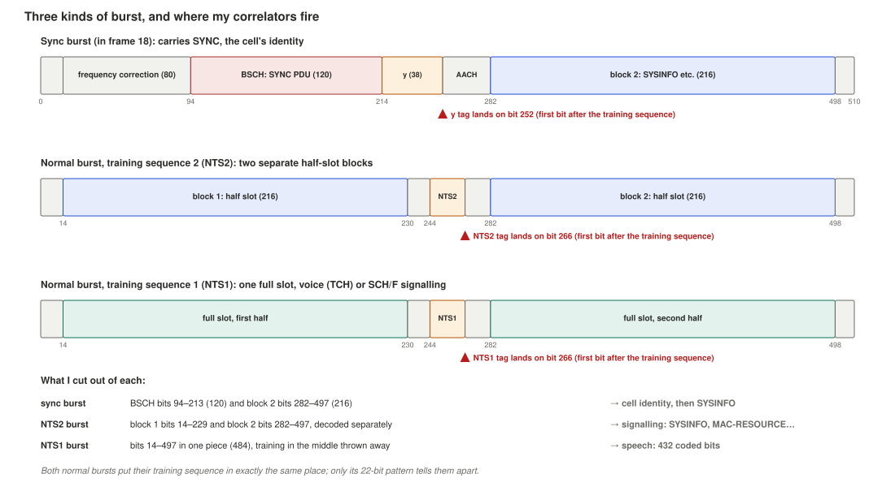

Every timeslot carries one **burst**. On the downlink there are three kinds I care about:

| Burst | Training sequence | What it carries |
|---|---|---|
| **Sync burst** | y, 38 bits | The **BSCH** (the SYNC message: who this cell is, and the time) plus a 216-bit block (often SYSINFO) |
| **Normal burst, NTS2** | 22 bits | **Two separate half-slot blocks** of 216 bits: signalling |
| **Normal burst, NTS1** | 22 bits | **One full slot** of 432 bits: **speech (TCH)** or full-slot signalling (SCH/F) |

A **training sequence** is a fixed bit pattern in the middle of each burst. The receiver knows it in advance, so it can search for it and find out exactly where the burst is. The two normal bursts put their training sequence in exactly the same place; only the 22-bit pattern tells them apart. That detail cost me a whole bug, as you'll see in Part 7.

---

## Part 2: the front end, from samples to soft bits

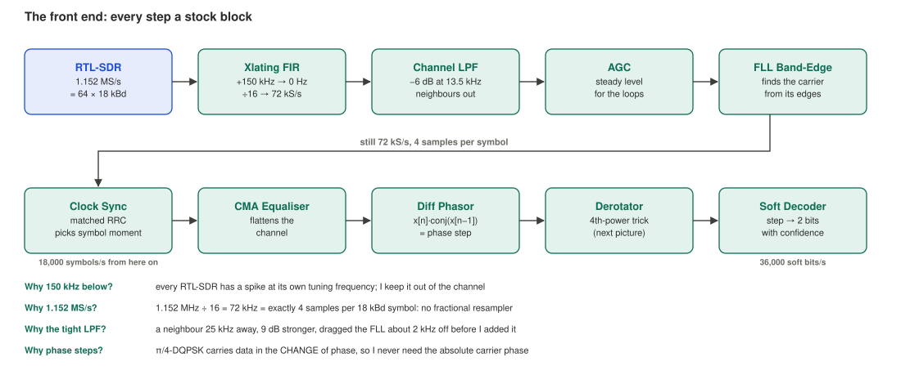

### Tuning in

1. **The dongle sits 150 kHz below the cell**, at 1.152 MS/s. Every RTL-SDR has a spike of junk at its own tuning frequency, so I keep the channel well away from it. Why 1.152 MS/s? Because 1.152 MHz ÷ 16 = 72 kHz, which is **exactly 4 samples per 18 kBd symbol**. One integer decimation, no fractional resampler anywhere.
2. **Frequency Xlating FIR**: slides the channel from +150 kHz down to 0 Hz, low-pass filters it, and keeps one sample in 16. Out come 72,000 samples per second.
3. **A tighter channel filter** (−6 dB at 13.5 kHz). I added this after I measured a neighbour 25 kHz away, 9 dB stronger than my cell, dragging the frequency loop about 2 kHz off.
4. **AGC**, so the loops after it see a steady level.

### Pulling out the tuning error

Neither the base station's oscillator nor my dongle's is perfect, so the signal arrives slightly off frequency. The **FLL Band-Edge** block fixes most of it: it compares the energy at the upper and lower edges of the signal's spectrum and nudges the frequency until they balance. Its estimate drives a **number display** with two readouts: "carrier offset" in Hz, and "ppm to add" for the dongle's correction slider.

### Finding the symbols

- **Polyphase Clock Sync**: the matched root-raised-cosine filter and symbol timing in one block. It goes from 4 samples per symbol to 1, choosing the best moment within each symbol.
- **CMA Equaliser** (16 taps): cleans up echoes and filter ripple. CMA works here because π/4-DQPSK symbols all have the same amplitude, so "make every symbol the same size" is a good target.
- **Diff Phasor**: multiplies each symbol by the conjugate of the previous one. What comes out is the **phase step**, which is where the data lives.

### The 4th-power trick

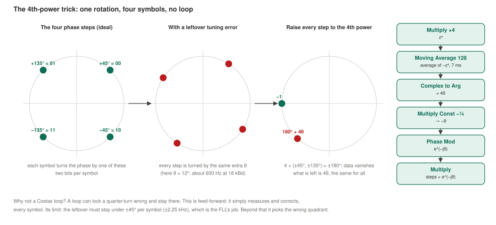

After the FLL, a little tuning error is always left over, so every phase step comes out turned by the same small extra angle θ. My favourite part of the front end removes it with six stock blocks and no feedback loop:

1. **Raise each step to the 4th power.** The four legal steps are ±45° and ±135°; times four, they *all* land on 180°. The data vanishes, and what's left is 180° + 4θ, the same for every symbol.
2. **Average** over 128 symbols (7 ms), take the angle, and divide by −4 to get the correction, −θ.
3. **Turn every step back** by that amount.

Why not a Costas loop? A loop can lock a quarter-turn wrong and stay there. This one has no memory and no lock state: it simply measures and corrects. Its limit is that the leftover has to stay under ±45° per symbol, about ±2.25 kHz, and keeping it there is the FLL's job.

The **constellation display** shows three things:

- **blue**: the symbols after clock sync. A thin ring means timing is locked.
- **red**: the corrected phase steps. Four tight clusters on the diagonals means healthy.
- **green**: the steps before correction. Their rotation is the leftover tuning error.

### Soft bits

The **Constellation Soft Decoder** turns each phase step into two **soft bits**. A soft bit isn't just 0 or 1: it's a number whose sign says which bit is likelier and whose size says how sure. Later, the Viterbi decoder uses that confidence to fix errors much better than plain 0/1 decisions would.

The "Soft-bit polarity" chooser on the GUI flips the sign convention. "Normal" is the one verified with `tetra_testgen.py`; flip it only if "no sync seen" persists while the red clusters look clean.

---

## Part 3: finding the bursts

### Correlators

A **correlator** slides along the bit stream looking for a known pattern. GNU Radio's **Correlate Access Code – Tag** does exactly that, and when it finds a match it attaches a **tag** to the stream: a little label riding on one sample.

I run three of them on the same soft-bit stream:

| Correlator | Pattern | Errors allowed | Finds |
|---|---|---|---|
| y | 38 bits | 4 | sync bursts |
| NTS2 | 22 bits | 1 | normal bursts with two half slots |
| NTS1 | 22 bits | 1 | normal bursts with a full slot (voice) |

Random data matches a 22-bit pattern with one error allowed about 0.2 times a second. Those **false hits** are harmless: the CRC and the rules in Parts 5 and 6 throw them out.

### Moving a tag with stock blocks

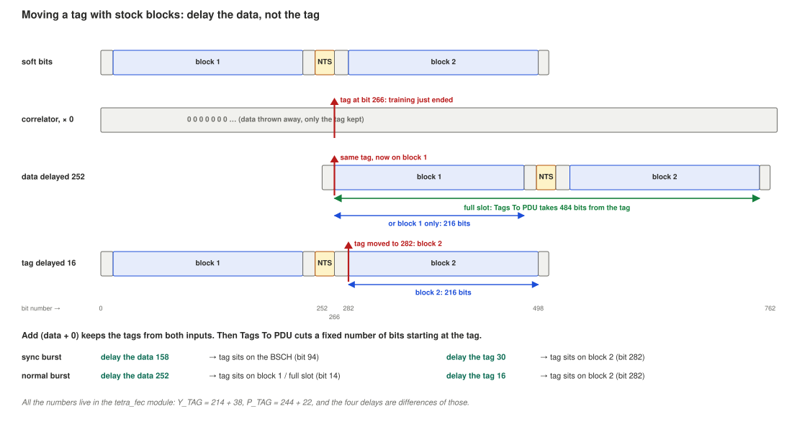

Here's the problem: the correlator tags the bit right *after* the training sequence (bit 266 of a normal burst), but the block I want starts at bit 14. The stock **Tags To PDU** block cuts a fixed number of bits starting *at* a tag. So I need the tag on bit 14.

The trick, all stock:

1. **Multiply the correlator output by 0.** The data becomes zeros; the tag survives.
2. **Delay the real data by 252 bits** with a Delay block.
3. **Add** the two. Data + 0 = data, and Add keeps the tags from both inputs.

Now the tag sits on bit 14 of the (delayed) burst. For block 2, I do the opposite: leave the data alone and delay the *tag* by 16 bits, so it lands on bit 282. Every offset lives in the `tetra_fec` module as the difference of two burst positions, so none of them is a magic number.

What gets cut:

| Burst | Cut | Goes to |
|---|---|---|
| Sync | BSCH (120 bits) + block 2 (216 bits) | BSCH chain, SCH/HD chain |
| NTS2 | block 1 and block 2 (216 bits each) | SCH/HD chain |
| NTS1 | the whole full slot, bits 14–497 (484 bits) | voice decoder (Part 6) |

---

## Part 4: undoing the armour

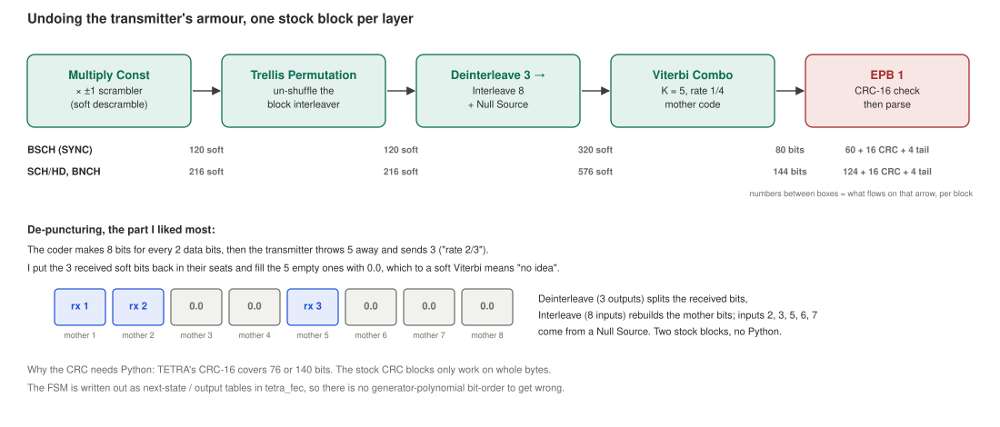

Before transmitting, the base station wraps every block in four layers of protection. I peel them off in reverse order, one stock block per layer:

1. **Scrambling** → **Multiply Const** by ±1. The transmitter XORs every bit with a pseudo-random sequence. On soft bits, XOR-with-1 is just "flip the sign", so descrambling is a multiplication by a ±1 vector.
2. **Interleaving** → **Trellis Permutation**. The transmitter shuffles the bits so a burst of noise damages bits spread over the whole block instead of a cluster. The permutation table un-shuffles them.
3. **Puncturing** → **Deinterleave** (3 outputs) into **Interleave** (8 inputs), with a **Null Source** on 5 of them. Explained below.
4. **Convolutional code** → **Viterbi Combo**: constraint length 5, rate 1/4. It finds the most likely original bits, using the soft bits' confidence.

Then the **CRC-16** check, in Python.

### De-puncturing, the part I like most

The convolutional coder makes **8 bits for every 2 data bits**, too many to send. So the transmitter throws 5 away and sends only 3 ("rate 2/3"). The receiver has to put the 3 survivors back in their seats and mark the 5 empty seats as **"no idea"**. For a soft Viterbi, "no idea" is simply 0.0: no vote either way.

Two stock blocks do it. Deinterleave splits the received stream into three, and Interleave rebuilds the eight mother bits, taking positions 1, 2 and 5 from the received streams and the rest from a Null Source. No Python at all.

One more small thing I'm glad I did: the code's state machine is written out as explicit next-state and output tables in `tetra_fec`. That way there's no generator-polynomial bit-order convention to get backwards.

---

## Part 5: the cell tells me its own key

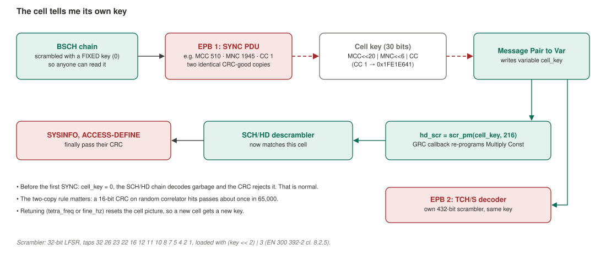

Here's a chicken-and-egg problem. Each cell scrambles its channels with **its own key**, built from its identity:

$$\text{key} = \text{MCC} \ll 20 \;|\; \text{MNC} \ll 6 \;|\; \text{colour code}$$

So to read the cell, I need its identity, and to get its identity, I need to read the cell.

TETRA's way out: the **BSCH** (in the sync burst) is scrambled with a **fixed key, 0**. Anyone can read it. It carries the SYNC message, which contains the MCC, MNC and colour code.

So my first Python block reads the SYNC, waits for **two identical CRC-good copies** (a 16-bit CRC on random correlator hits passes about once in 65,000, and I don't want a fluke reprogramming everything), builds the key and publishes it as a message. A stock **Message Pair to Var** block writes it into the `cell_key` variable. A GRC callback recalculates the scrambling vector and reprograms the SCH/HD descrambler, and from that moment SYSINFO and ACCESS-DEFINE pass their CRCs. The voice decoder gets the same key for its own 432-bit scrambler.

On the live cell I tested at 391.025 MHz, that's MCC 510 (Indonesia), MNC 1234, colour code 60: key 0x1FE134BC. As soon as two matching SYNCs are in, the voice block reports `armed for cell key 0x1FE134BC`, and SYSINFO starts passing its CRC.

### What the console tells me

Every 10 seconds, the first Python block prints a status panel:

- **Network**: MCC, MNC, colour code.
- **SYNC**: system version, carrier sharing mode, reserved frames, DTX, cell load, neighbour-cell broadcast, and TDMA time (TN, FN, MN) at the last SYNC.
- **SYSINFO**: the **main carrier** and its downlink and uplink frequencies, location area, minimum receive level, mobile power limit, access parameters, and **services**: registration, voice, circuit data, packet data, and **AIR ENCRYPTION** when the cell *offers* encryption (which is not the same as every call being encrypted; see Part 7).
- **ACCESS-DEFINE**: the random-access rules.
- **Tuning check**: the main carrier the cell announces, minus the frequency I'm tuned to. Within 1 kHz: "receiver calibrated". Within 12.5 kHz: "you're on the main carrier but N kHz off; add X ppm". Further away: "secondary carrier".
- **Decoder**: how many bursts were cut and how many passed CRC. A low ratio on half-slot cuts is normal, because they include the correlator's false hits.
- **TCH/S ref**: the timing reference for the voice decoder (Part 6).

---

## Part 6: the voice path

### Why a DLL

TETRA speech uses **ACELP** at 4.567 kbit/s: one 137-bit frame every 30 ms. Two of those, plus channel coding, fill one full slot's 432 bits.

The ETSI reference code for both the channel decoding and the speech synthesis is a few thousand lines of carefully fixed-point C. Rewriting it in Python would be slow and never bit-exact. So I built it into `tetra_dec.dll`, checked it against the ETSI test programs with `verify_bitexact.py`, and call it from Python with `ctypes`. It's the one place this project steps outside "stock blocks plus small Python". There is no stock ACELP block, so I think the rule allows it.

### Which timeslot is this?

This was the hard part. Every full-slot burst from every timeslot comes out of the same correlator. If I fed them all to the speech decoder, I'd be mixing up to four different conversations, plus full-slot signalling, plus false hits. I need to know **which timeslot and which frame** each burst belongs to.

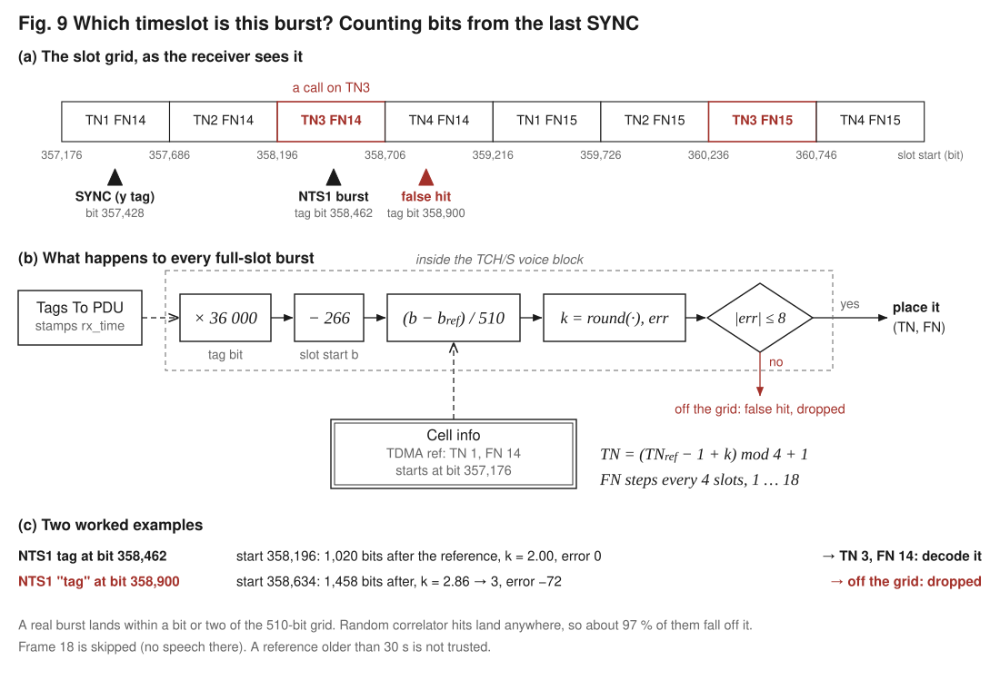

The trick uses something Tags To PDU already does. It stamps every piece it cuts with `rx_time` = tag position ÷ rate. I set the rate to 36,000 bits per second, so **rx_time × 36,000 is the absolute bit number** of that tag. And all my cutters sit on the same soft-bit stream, so they all count bits the same way.

So:

1. **The first Python block** also receives the raw BSCH cuts. Whenever a SYNC of my cell passes CRC, it pairs that SYNC with its raw cut and sends a **TDMA reference**: "TN 1, FN 14 starts at bit 357,176".
2. **The voice block** takes each full-slot burst, works out where its slot starts (tag bit − 266), and counts slots from the reference: k = round(distance ÷ 510). TN goes up by k, wrapping 4 → 1; FN goes up every 4 slots, wrapping 18 → 1.
3. **A real burst lands on the slot grid**, within a bit or two. I allow ±8 bits. A correlator false hit lands anywhere, so about 97 % of them fall off the grid and get dropped for free.

Two small details took some care:

- The decoded SYNC and its raw cut reach the first block by different paths, so they can arrive in either order. I pair them by sequence number: the BSCH chain is strictly one PDU in, one PDU out, in order, so the n-th raw cut belongs to the n-th decoded SYNC.
- A reference older than 30 seconds isn't trusted, in case the bit count slipped. Sync bursts come every multiframe anyway.

### From a full slot to speech

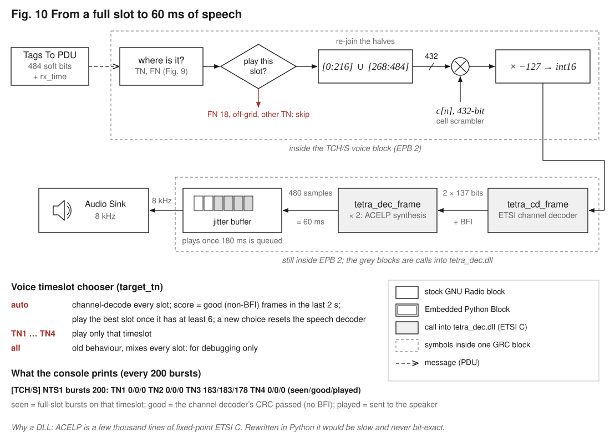

For each burst that survives the timeslot gate:

1. **Re-join the two halves**: bits [0:216] and [268:484] of the cut, skipping the training sequence in the middle: 432 coded bits.
2. **Descramble** with the cell's 432-bit sequence, scale to ±127 and convert to 16-bit integers, the format the ETSI decoder expects.
3. **`tetra_cd_frame`**: the ETSI channel decoder. It returns two 137-bit speech frames plus a **BFI** ("bad frame indicator") flag when its CRC fails.
4. **`tetra_dec_frame`**, twice: ACELP synthesis. 2 × 240 samples = 60 ms of 8 kHz audio.
5. **Jitter buffer**: speech arrives in 60 ms lumps every 56.67 ms, but the sound card wants a smooth stream. So I wait until 180 ms is queued before starting to play, and if it ever runs dry, I wait for 180 ms again. No more silence spliced between every chunk.

### Choosing the timeslot

A **"Voice timeslot"** chooser on the GUI:

| Setting | What it does |
|---|---|
| **auto** (default) | Runs the channel decoder on every slot and keeps a score: good (non-BFI) frames per timeslot over the last 2 s. Plays the best slot once it has at least 6. When it switches, it resets the speech decoder. |
| **TN1 … TN4** | Plays only that timeslot. |
| **all** | The old behaviour: everything mixed. For debugging only. |

Frame 18 is always skipped (no speech there). Every 200 bursts the console prints a line like this one, from about 18 minutes on the live cell:

```
[TCH/S] NTS1 bursts 14802: TN1 610/38/33  TN2 6630/6555/4047  TN3 4119/4048/2943  TN4 3209/3178/1755  unknownTN 0/0/0  (seen/good/played)
        dropped: off-grid 90, FN18 144, no SYNC ref 0, bad len 0
```

I love how much that one line says:

- **TN2, TN3 and TN4 carried calls**, often at the same time. 98–99 % of their frames passed the speech channel decoder's CRC.
- **TN1 is the control timeslot.** Its full-slot bursts are signalling, not speech, so only 6 % "pass", by accident. Auto mode never picked it, exactly as it shouldn't.
- **"Played" is lower than "good"** because only one timeslot plays at a time. When three calls overlap, two of them are decoded, scored and not played.
- **Not one burst had an unknown timeslot**, and only 0.6 % were thrown out as off-grid false hits.

While calls come and go, the console also narrates the auto selector: `auto: playing TN 2`, `auto: no call heard`, `auto: playing TN 3`… A pause in a push-to-talk conversation longer than about 2 seconds drops the score below 6 and prints "no call heard"; the next words bring it straight back.

---

## Part 7: war stories

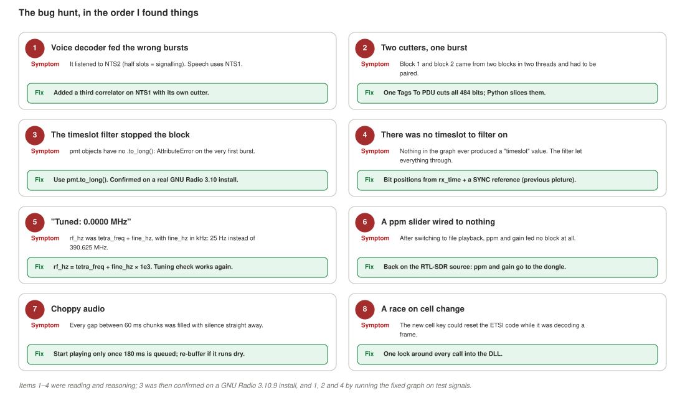

The cell-info half of this receiver worked early on: it had already decoded cells of MNC 1945 at 393.075 MHz (location area 105) and 393.300 MHz (location area 102). The voice add-on was another matter. Here's what was wrong with my first version, in the order I found it.

### 1. Listening to the wrong training sequence

My first voice decoder took its bursts from the same cutters as the signalling chain: the ones triggered by **NTS2**. It took me a while to see the problem, because the code *looked* right. Two 216-bit blocks, joined, descrambled, decoded.

But NTS2 means "this slot is split into two half slots", which is signalling. Full-slot speech uses **NTS1**, a different 22-bit pattern in exactly the same position, and nothing in my flowgraph was looking for it. My speech decoder was being fed SYSINFO and MAC messages and politely turning them into noise.

The fix was a third correlator on NTS1 with its own cutter. Lesson: **"same place in the burst" is not "same kind of burst."** The pattern is the only thing telling them apart.

### 2. Two cutters for one burst

My first NTS1 fix used two Tags To PDU blocks, one for each half. They run in separate threads, so the two halves arrived as two separate messages, and I had to hope they came in the right order to pair them. Usually they would. "Usually" isn't a design.

Now one Tags To PDU cuts all 484 bits, and Python slices out the two halves. One cutter fewer, and pairing can't go wrong.

### 3. A timeslot filter that stopped the block

I added a timeslot filter that read a `timeslot` value from each message's metadata, using `.to_long()`. In GNU Radio's Python bindings, PMT objects don't have that method; `pmt.to_long(x)` is a function. I confirmed it on a real GNU Radio 3.10.9 install:

```
AttributeError: 'pmt.pmt_python.pmt_base' object has no attribute 'to_long'
```

That error fires on the very first burst. GNU Radio logs it, and the block's thread stops. The symptom is silence, with one error line scrolled away near the top of the console.

### 4. …and there was no timeslot anyway

Even with that fixed, nothing in my flowgraph ever *produced* a `timeslot` value. So the lookup always returned the default (−1), which my own condition then let straight through. The filter was a no-op.

That's what led to the `rx_time` method in Part 6. Lesson: **before filtering on a field, find out who writes it.**

### 5. "Tuned: 0.0000 MHz"

The first Python block's frequency parameter was set to `tetra_freq + fine_hz`. But `fine_hz` is in kHz. With `tetra_freq` at 0 (left over from file playback), the status panel said I was tuned to 25 Hz, and the tuning check always claimed I was on a "secondary carrier". It's now `tetra_freq + fine_hz*1e3`, with real frequencies everywhere.

### 6. A slider wired to nothing

When I switched from the dongle to file playback, the `ppm` and `rf_gain` sliders stayed on the GUI, connected to no block at all, while the status panel kept telling me to "add N ppm to Freq corr". With the RTL-SDR source back, both go to the dongle again, and ppm is applied in the dongle itself, correcting both the tuning and the sample clock.

### 7. Choppy audio

The voice block filled every gap with silence the instant its buffer ran empty. With speech arriving in 60 ms lumps, that meant a little gap after almost every lump. Hence the 180 ms jitter buffer.

### 8. A race on cell change

When a new cell key arrived, the `cell_key` setter reset the ETSI decoder from one thread while the message handler might be in the middle of decoding a frame in another. The ETSI code keeps global state and wasn't written for that. One lock around every call into the DLL fixed it.

### Two more lessons from the first live run

**The "AIR ENCRYPTION" line that didn't mean what I thought.** My live cell's SYSINFO said, every single time, `Services: … voice, circuit data, AIR ENCRYPTION`. I had written (in an earlier draft of this very document) that such a cell would give me nothing but noise. Then the calls came out clear.

The flag is one bit in SYSINFO's "BS service details", and what it really says is "air-interface encryption is *available* on this cell". Whether a particular call is encrypted is decided call by call. So the flag tells you encryption is possible; only listening tells you whether this call uses it. And a warning for anyone reading the counters: encryption is applied *before* the channel coding, so an encrypted call still passes the channel decoder's CRC. Its frames show up as "good" and still sound like noise. Lesson: **read the spec's wording, not the field's name.** My status panel's label is shorter than the truth.

**The error lines that weren't errors.** Every minute or so the live console printed something like:

```
tags_to_pdu :error: SOB tag received during burst 13332 at offset 34300000, previous burst dropped (1 tags total)
```

That's the new full-slot cutter. A correlator false hit (or a second real tag) arrived while it was still collecting its 484 bits, so it dropped that cut and started again. My flowgraph already has a little snippet that silences exactly this message from the three original cutters, because it's harmless; I simply forgot to add the fourth one. In the six minutes of log I kept, it happened 19 times, against more than 4,000 good full-slot bursts. Lesson: **when you add a block, check whether its siblings had special treatment.** (The fourth cutter is in the snippet now.)

---

## Results

### On air: a live cell, RTL-SDR, about 18 minutes

The real test. RTL-SDR on the Soapy source, with `tetra_freq` set to the cell's main carrier, **391.025 MHz**:

| What | Result |
|---|---|
| **Cell** | MCC 510, MNC 1234, colour code 60, location area 1005, EN 300 392-2 V3.1.1+ system, continuous transmission |
| **Main carrier announced** | 391.025 MHz down, 381.025 MHz up. Tuning check: **+0.0 kHz, "receiver calibrated"** |
| **SYNC (BSCH)** | 33,616 of 33,633 cuts passed CRC: **99.95 %** |
| **Half-slot signalling** | 87,729 of 88,266 cuts passed CRC: **99.4 %** (and that includes the correlator's false hits). 60,508 SYSINFO, 27,025 MAC-RESOURCE, 196 MAC-FRAG/END |
| **Voice timeslots** | TN2: 6,555 of 6,630 good (98.9 %). TN3: 4,048 of 4,119 (98.3 %). TN4: 3,178 of 3,209 (99.0 %) |
| **Control timeslot** | TN1: 38 of 610 "good" (6 %): signalling, correctly never played |
| **Timeslot tracking** | 0 bursts with an unknown timeslot; 90 of 14,802 (0.6 %) dropped as off-grid false hits; frame 18 skipped |
| **Speech** | **Clear calls**, following whichever timeslot was busy |

Those 98–99 % "good" figures also answer the two questions I'd left open before going on air:

- **The soft-bit sign for the ETSI decoder** (`polarity = −1`) is right. With the wrong sign, almost nothing would pass the speech channel decoder's CRC.
- **Auto mode works.** It runs the channel decoder on every timeslot to score them, which assumed the decoder keeps no memory between frames that matters. With three timeslots carrying calls at once and all three scoring 98–99 %, the assumption holds in practice.

### At my desk: synthetic signals

Before going on air I tested everything I could with signals I generated myself:

| Test | Result |
|---|---|
| **Compile** in GNU Radio 3.10.9 (`grcc`) | Clean, including the Soapy RTL-SDR source |
| **Synthetic cell** from `tetra_testgen.py`: 18 dB Es/N0, +400 Hz offset, replayed twice: like my gqrx recording (channel at +25 kHz), and like the live dongle (channel at +150 kHz) | Both: cell, SYSINFO and ACCESS-DEFINE decoded. First run: 176 of 177 BSCH cuts passed CRC |
| **Timeslot tracking** on the same signal (full-slot bursts exist only on TN3) | All placed on TN3 (183 of 183, and 184 of 184 in the second layout); frame 18 bursts dropped (10 of 193, about 1 in 18 as expected); false hits rejected as off-grid |
| **Timeslot chooser** | TN2 → nothing played; TN3 → everything played; auto → picked TN3 |
| **Jitter buffer** | Silent until 180 ms queued, then plays continuously |
| **`.to_long()` crash** | Reproduced on a real install, then gone |

For those desk tests I used a stand-in DLL with the same functions as `tetra_dec.dll` (every frame "good", output a 400 Hz tone). It exercised the whole Python and `ctypes` path; the live run then proved the real speech decoder.

Earlier, before any of the voice work, the cell-info half had also decoded cells of MCC 510 / MNC 1945 at 393.075 MHz (LA 105) and 393.300 MHz (LA 102).

---

## How to run it

1. Open **tetra_rx_stock.grc** in GRC (GNU Radio 3.10, radioconda).
2. Put **tetra_dec.dll** in the folder where GRC writes `tetra_rx_stock.py`. Without it everything still runs except the audio. If you built it with MinGW, copy its runtime DLLs there too.
3. Check the variables:
   - `tetra_freq`: the cell you want, in Hz (default 390.625e6). `lo_offset` = 150e3 keeps the dongle's spike out of the way.
   - `ppm`: your dongle's crystal error. 35 for mine; about 0 for a TCXO dongle (RTL-SDR Blog v3/v4).
4. Run. Start the RF gain around 25 dB and back off if the spectrum floor rises.
5. Watch the console. Within a few seconds you get a `CELL` line and `[TCH/S] armed for cell key …`, then SYSINFO, and every 10 seconds a status panel. Here's a piece of one from my live run:

```
 Tuned        : 391.0250 MHz
 Network      : MCC 510  MNC 1234 (0x04D2)  colour code 60   [MCC 510 = Indonesia]
 SYNC         : EN 300 392-2 V3.1.1+; continuous transmission; 1 reserved frame(s); U-plane DTX no; frame-18 ext no
 TDMA time    : TN 4  FN 12  MN 54 (at last SYNC)
 TCH/S ref    : TN 4 FN 12 at bit 26300414, 0 s ago
 Main carrier : 3641  band 3  offset +0.00 kHz  ->  DL 391.0250 MHz   UL 381.0250 MHz
 Location area: 1005   subscriber classes 1111111111111111   secondary CCHs 0
 Tuning check : announced main carrier minus tuned frequency = +0.0 kHz  (you are on the main carrier, receiver calibrated)
 Decoder      : BSCH cuts 22066 (CRC ok 22055)   half-slot cuts 59559 (CRC ok 59193)
```

6. **Calibrate**: adjust `ppm` by the "ppm to add" readout until the carrier offset is under about 300 Hz. Then the Tuning check should say "receiver calibrated".

On the GUI:

- **Spectrum (72 kHz)**: your cell at 0 Hz, neighbours at multiples of ±25 kHz.
- **Constellation**: four tight red clusters on the diagonals = healthy.
- **FLL number display**: if the offset sits near ±6 kHz, fix `ppm`.
- **Soft-bit polarity**: leave on "normal" unless nothing decodes while the constellation looks clean.
- **Voice timeslot**: auto, TN1–TN4, or all.

A few notes:

- **Retuning while running**: the Soapy source's Frequency Correction is `ppm + 0*rf_fc` on purpose. SoapySDR resets the ppm correction on every retune, and the dummy term makes GRC re-apply it. With the Osmocom RTL-SDR source, plain `ppm` is fine.
- **To play a recording**: disable the RTL-SDR source, enable File Source, Rational Resampler and Throttle, and set `rf_fc` to the recording's centre (for my gqrx file, 390.6e6).
- **"No SYNC decoded yet"**: check frequency, ppm, gain, and the polarity chooser, in that order.
- **SYNC fine but no SYSINFO for a long time**: the cell key isn't confirmed yet (it needs two identical copies), or you're tuned to a secondary carrier that carries little broadcast traffic.
- **Voice "good" stays near 0 % on every timeslot**: something is wrong before the speech decoder. Check the TCH/S ref line has a recent reference, then try the other `polarity` on the voice block. (On my live cell, the default `polarity = −1` gave 98–99 %.)
- **Voice "good" near 100 % but it sounds like noise**: that call is almost certainly encrypted. Encryption happens before the channel coding, so the CRC still passes. Nothing to fix.
- **`tags_to_pdu :error: SOB tag received during burst`**: harmless (Part 7). The current flowgraph silences it; older copies didn't include the fourth cutter in the `quiet_cutters` snippet.

---

## TODO

There's a lot of room for improvement!

- **Tell clear calls from encrypted ones**: MAC-RESOURCE messages carry an encryption-mode field for the signalling inside them. Whether that's a reliable hint about the voice in the same call is worth finding out; if it is, the console could flag an encrypted timeslot before I even listen.
- **Gentler auto switching**: a 2-second pause in a conversation currently prints "no call heard" and may hop to another busy timeslot. A little hold time on the current slot would make it follow one conversation better.
- **A TCH test mode in `tetra_testgen.py`**, using real ETSI-coded frames, so the voice path can be regression-tested at my desk.
- **Follow calls properly**: read the channel assignments in MAC-RESOURCE / D-SETUP messages instead of guessing by "good frame" score. That would also handle calls on secondary carriers.
- **Show more of the signalling**: neighbour-cell lists, D-NWRK-BROADCAST, and SDS messages that aren't encrypted.
- **Stealing**: during a call, the network can "steal" half or all of a traffic slot for signalling (STCH). A stolen slot is sent with NTS2, so my voice path never sees it, and that 60 ms is simply missing. Telling the ETSI decoder about the gap (so it can conceal it) would sound better.
- A long unattended run, to see how stable the TDMA reference stays over hours.

---

## Acknowledgements

- The **GNU Radio** project, and **radioconda** for making it painless on Windows.
- **osmocom / rtl-sdr** and the **SoapySDR** developers.
- **ETSI**, for EN 300 392-2 (the air interface) and EN 300 395-2 (the speech codec), with reference C code that made `tetra_dec.dll` possible.
- **osmo-tetra** (Harald Welte, Sylvain Munaut, Dieter Spaar and others), whose code I used to cross-check the training sequences and burst offsets.
- The TETRA base stations around me, for transmitting nonstop and never once getting bored of telling me who they are.

## Other SDR Receiver Project
- [DMR Voice Receiver](https://handiko.github.io/DMR-Voice-Receiver/)
- [GPS L1 C/A Receiver](https://handiko.github.io/GPS-L1-CA-Rx/)
